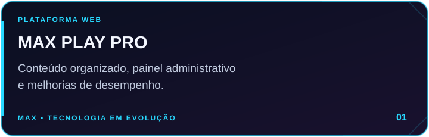
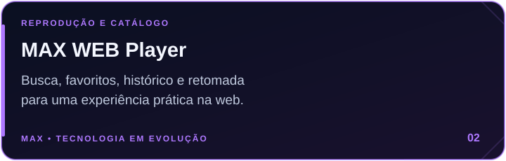
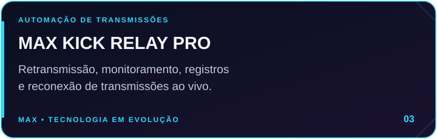
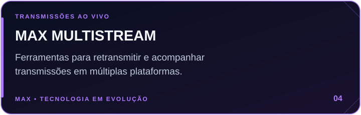
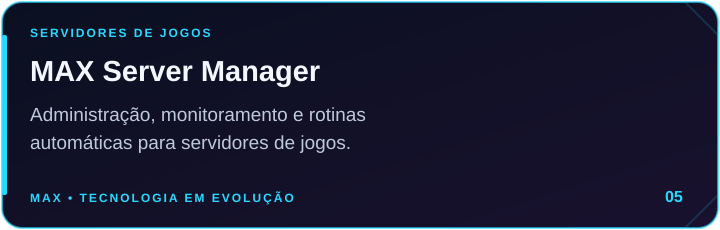

## 🎮 Sobre a MAXPTV

Sou apaixonado por tecnologia, desenvolvimento de sistemas, infraestrutura, streaming e automação. Crio soluções web e ferramentas para simplificar operações, melhorar desempenho e transformar ideias em projetos reais.

- 🚀 Foco em **sistemas web, painéis administrativos e automações**.
- 🛠️ Interesse em **servidores, redes, monitoramento e desempenho**.
- 🎯 Missão: construir experiências práticas, rápidas e intuitivas.
- 🇧🇷 Interfaces e documentação em **português do Brasil**.

## 🕹️ Projetos em destaque

  
  

  
  

  

Os projetos representam minhas áreas de atuação: plataformas web, reprodução de mídia, automação de transmissões e servidores de jogos.

## ⚡ Tecnologias e ferramentas

**Desenvolvimento web**

  

**Automação e ambiente de trabalho**

  

**Infraestrutura e servidores**

  

## 🛠️ O que construo

- **Painéis administrativos:** configurações, gerenciamento de usuários e ferramentas para facilitar a operação.
- **Experiências de reprodução:** catálogo, busca, favoritos, histórico e retomada.
- **Automação de transmissões:** monitoramento, registros, reconexão e acompanhamento de lives.
- **Infraestrutura gamer:** administração de servidores de jogos, agendamentos e manutenção.

## 📊 Estatísticas do GitHub

Os indicadores abaixo são gerados por serviços externos e podem ficar temporariamente indisponíveis. As linguagens refletem os repositórios públicos analisados pelo serviço.

[Ver atividade diretamente no GitHub](https://github.com/dissedias?tab=overview)

## 🌐 Conecte-se

**MAX • Código, criatividade e evolução constante.**

MAX Gamer PRO • V2.0

